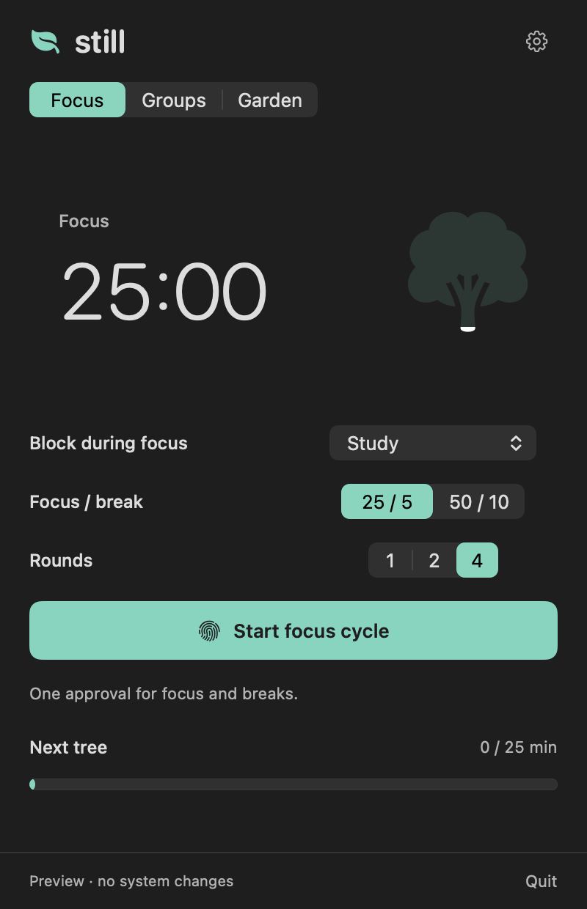

# Still

A native macOS menu bar focus timer and website blocker by viciousbuilders. Keep everyday distractions blocked, open study websites during breaks, and grow a small virtual garden with your focus time.

[Still](https://viciousbuilders.com/still) · [Source code](https://github.com/viciousbuilders/still)



## Build and open

Requires macOS 13+ and Xcode Command Line Tools. No dependencies or accounts.

```sh
git clone https://github.com/viciousbuilders/still.git
cd still
./scripts/build.sh
open dist/Still.app
```

Click the menu bar shield and open **Groups**. Select a group to edit its websites, choose **Always on** or a session length under **Duration**, and click **Block group**. On Macs with Touch ID, macOS asks for an administrator password once to set up the helper, then uses Touch ID or your Mac password for manual changes. Updating the helper or pairing a different user requires administrator setup again. Macs without Touch ID keep the administrator password prompt for manual changes. **Unblock group** is always available for groups outside a focus cycle; there is no locked mode. List edits during a block take effect only after **Apply changes**. After upgrading from a hosts-only version, click **Apply changes** once to add firewall protection to the current block.

Use **+** in Groups to create a group, and **…** to rename or delete it. Existing website lists migrate into a **Websites** group. Each group has its own duration and blocking state; multiple groups can run together. For example, keep Facebook, TikTok, and Threads in **Always blocked**, and put Instagram, LinkedIn, and X in **Study**. If an existing combined list includes those study websites, Focus offers a preview that splits them into Study and keeps the remaining websites in Always blocked. Applying the split to an active block requires authentication. If a website belongs to two active groups, it stays blocked until both are stopped or expire. Edits in one group never apply another group's unfinished changes. Unblock a group before deleting it. **Settings → Unblock all groups** stops everything, including a scheduled cycle. Up to 50 groups can be saved, with up to 500 website entries across the active groups.

## Focus and garden

In **Focus**, select the group to block during focus, choose **25/5** or **50/10**, and choose 1, 2, or 4 rounds. One Touch ID or administrator approval authorizes the whole plan. Study blocks during each focus period, opens during each break, and blocks again for the next round. Other groups keep their current settings. Four rounds end with a 15-minute break (25/5) or 20-minute break (50/10); shorter cycles end with their normal break. After the final break, the cycle ends and its group stays open.

The helper owns the schedule, so closing Still does not stop transitions. A sleeping Mac catches up to the current phase after waking. The menu bar shows the countdown while a cycle runs. **End cycle early** requires authentication, opens only the cycle's group, and preserves earned progress. Its website snapshot is fixed for the cycle; edits apply to the next one. Shared websites in another active group stay blocked during breaks, with an explanation in Focus.

After three completed short focus blocks, Still suggests trying 50/10. After an interrupted long block, it suggests 25/5. Suggestions change your next cycle only when selected.

**Garden** records focus minutes and grows one virtual tree per 25 recorded minutes. Partial progress carries into later cycles. Breaks, sleep, clock jumps, helper downtime, and intervals without the planned group applied earn no progress. The helper compares awake and wall clocks, checkpoints progress every five seconds, and archives completed or interrupted blocks without double counting. Garden data stays on this Mac; no account or cloud service is used.

Use the gear button for **Open Still at login** and details about blocking. For a stable login-item path, copy `dist/Still.app` into `/Applications` before enabling it. The build script produces a locally ad-hoc-signed app for the current Mac architecture; it is not a notarized distribution release.

An interactive preview lets you try the controls without changing your hosts file, installing the helper, saving preferences, or enabling a login item:

```sh
open dist/Still.app --args --demo
```

Quit an existing instance before switching between normal and preview mode.

To check the actual menu bar popover instead of the standalone preview window:

```sh
open dist/Still.app --args --demo --menu-preview
```

Preview mode also accepts `--light` and `--dark` to check both appearances without changing system settings.

To export the native preview for documentation, add `--export-preview /absolute/path/preview.png` in standalone preview mode. The app saves its rendered content and quits.

## Blocking behavior

- Blocks listed domains and their `www` versions using IPv4 and IPv6 entries in `/private/etc/hosts`, plus macOS PF firewall rules for their resolved server addresses. Both TCP and UDP are blocked, including HTTPS and QUIC.
- Clears existing PF connection state only for blocked destination addresses when applying rules. Other connections and other applications’ firewall rules are preserved. Already downloaded pages, images, and videos can remain visible or playable.
- Resolves server addresses through direct DNS queries before installing rules, bypassing Still’s own hosts entries. Addresses refresh every five minutes; older addresses remain blocked for the duration of that domain’s block so existing connections cannot escape a DNS change. New domains that cannot be resolved cause the update to fail without replacing the current block.
- Uses the standard macOS `com.apple/*` wildcard anchor to load only Still’s child anchor, `com.apple/000.com.viciousbuilders.still`. It never rewrites `/etc/pf.conf`, replaces an already-loaded main ruleset, globally clears connections, or disables another application’s PF enable reference. Custom firewall configurations without the standard unconditional wildcard anchor, or with earlier quick pass rules that could bypass it, are rejected.
- Preserves existing hosts-file entries, including entries added by other tools while a block is active. Only the section between `# BEGIN STILL WEBSITE BLOCKER` and `# END STILL WEBSITE BLOCKER` belongs to Still.
- Always-on groups persist through app quits, logouts, and restarts. Ending them requires **Unblock group**, not just quitting or deleting the app.
- Timed groups use a root-owned LaunchDaemon with absolute expiry times. Its watcher checks transitions each second and removes only expired groups, preserving other groups and shared websites. Firewall health checks run every 15 seconds and DNS addresses refresh every five minutes. launchd retries an exited watcher every 15 seconds. A sleeping Mac catches up after waking. The watcher stays available through breaks and unloads itself after the last group and cycle end.
- Administrator cancellation leaves the current block unchanged. Website input is validated again by the helper before any privileged writes.
- Touch ID approval signs the exact requested change with a device-bound Secure Enclave key protected by user presence. The root helper verifies the signature against the public key paired during administrator setup, accepts only that user's connections, and rejects altered, expired, or replayed approvals. Still never receives your fingerprint or password. The authorization helper remains available after stopping a block; the separate expiry job still unloads itself.
- No browsing-history collection, analytics, cloud services, or installed-app blocking. The helper makes DNS queries to resolve blocked websites.

Blocking remains a deterrent rather than a tamper-proof lock. VPNs, proxies, and server addresses not yet discovered by Still may bypass it. Browser Secure DNS can use different server addresses from the system’s DNS, so disable it if a site remains reachable. IP blocking can also affect unrelated sites hosted at the same server address. Still does not close tabs, erase cached page content, or install a browser extension. It does not promise SelfControl’s resistance to tampering.

Hosts files do not support wildcard domains. Add `old.reddit.com` separately from `reddit.com`, for example. Paths in pasted URLs are removed: blocking a URL blocks its whole domain, not just that page. International domains must be entered in ASCII / punycode form. Internal hostnames, IP addresses, and wildcards are rejected.

## Recovery and uninstall

First end any focus cycle and turn off blocking in Still. If the app is unavailable, the installed helper can cancel its schedule and remove its block:

```sh
sudo "/Library/Application Support/Still/StillHelper" --remove
```

If the installed helper is missing, rebuild and use the bundled helper:

```sh
sudo "dist/Still.app/Contents/Helpers/StillHelper" --remove
```

If someone manually damaged Still’s markers, the helper refuses to guess which unrelated lines to delete. Use `sudo nano /private/etc/hosts` to remove only Still’s section and its domain entries, preserving the host database and other tools’ rules. Then run `--remove` again to clear the saved state and scheduled job. An initial reference backup is in `/Library/Application Support/Still/hosts-before-still`; do not restore the whole backup over newer entries from other tools.

To uninstall completely: turn off the login toggle, turn off blocking, quit Still, delete its app bundle, and remove its root-owned support directory. If Touch ID setup was completed, first unload its authorization helper and remove its launchd file (skip the first two commands if it was never installed):

```sh
sudo launchctl bootout system/com.viciousbuilders.still.authorization
sudo rm /Library/LaunchDaemons/com.viciousbuilders.still.authorization.plist
sudo rm -r "/Library/Application Support/Still"
rm -f "$HOME/Library/Application Support/Still/block-approval.key"
```

Never delete the helper while a block or focus cycle is still active. Merely deleting the app leaves blocking and scheduled transitions in place.

## Development and verification

```sh
swift test
./scripts/build.sh
codesign --verify --deep --strict dist/Still.app
```

Tests use temporary hosts files and support directories. They cover normalization, malicious input, malformed markers, existing custom rules, updates, rollback, symlink refusal, persisted timers, IPv4/IPv6 firewall rules, targeted connection-state removal, DNS refresh, and restoration. Group tests cover migration, independent blocking, overlapping websites, expiry, unapplied drafts, and management. Focus tests cover exact phase boundaries, long breaks, automatic transitions with the UI closed, independent always-on groups, early ending, rollback, sleep/restart/clock changes, verified progress, and idempotent garden records. Authorization tests check signed changes and schedules, tampering, wrong keys, expiry, and replay rejection. Tests never alter the real hosts file, access `/dev/pf`, or launch a system daemon. Before release, check first-use administrator setup, real Touch ID and password fallback, cancellation, app relaunch, helper upgrades, PF enforcement, and the root launchd lifecycle on a Mac with Touch ID.

`BlockerCore` holds domain validation and hosts-file transformations. `BlockerAuthorization` defines the narrow XPC protocol and verifies single-use signed requests. `BlockerSystem` owns transactional writes, firewall enforcement, DNS resolution, expiry scheduling, and administrator-approved authorization setup. `StillHelper` exposes a root-only command interface and an authenticated XPC service. `Still` is the SwiftUI menu bar UI; it uses CryptoKit and LocalAuthentication for Touch ID approvals and the standard administrator prompt for setup and Macs without Touch ID. The encrypted key representation is stored in the user's Application Support directory; the private key remains protected by the Secure Enclave. This supports local ad-hoc builds without provisioned keychain entitlements. The app reads the actual hosts section and helper state rather than assuming a saved UI preference means a block is active.

Inspired by [SelfControl](https://github.com/SelfControlApp/selfcontrol/) and the menu bar utility feel of [Pipet](https://github.com/viciousbuilders/pipet). This is an independent implementation; no SelfControl source code was copied.

## License

MIT. See [LICENSE](LICENSE).
